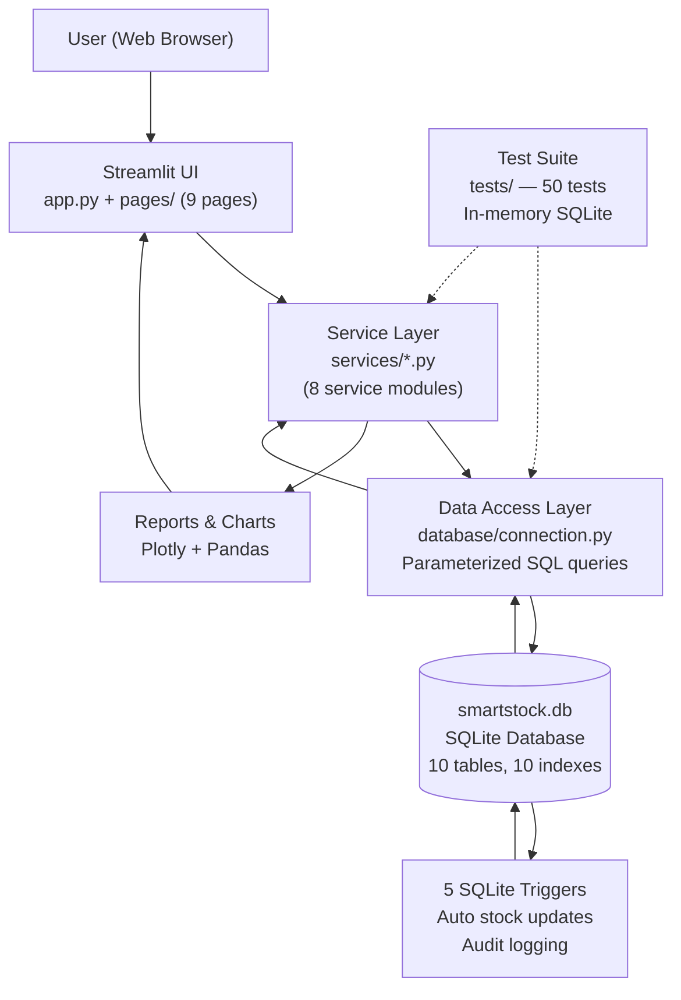
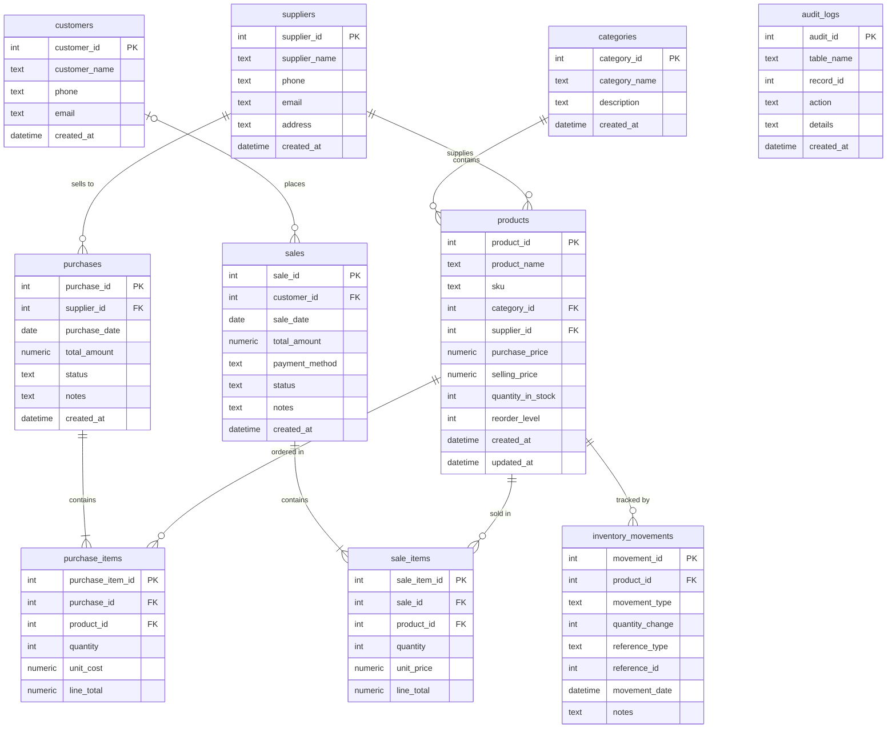

# SmartStock: A Relational Database System for Inventory, Sales Reporting and Automated Stock Management Using SQLite


> **Created by Anand D , Ganesh M , Mallikarjunaswamy C**
> MCA Academic Mini-Project | SQLite | Python | Streamlit

---

## Table of Contents

1. [Project Overview](#1-project-overview)
2. [Problem Statement](#2-problem-statement)
3. [Objectives](#3-objectives)
4. [Features](#4-features)
5. [Technology Stack](#5-technology-stack)
6. [System Requirements](#6-system-requirements)
7. [Application Architecture](#7-application-architecture)
8. [Project Structure](#8-project-structure)
9. [Database Design](#9-database-design)
10. [Entity-Relationship Diagram](#10-entity-relationship-diagram)
11. [Schema and Constraints](#11-schema-and-constraints)
12. [SQLite Concepts Demonstrated](#12-sqlite-concepts-demonstrated)
13. [Key SQL Queries](#13-key-sql-queries)
14. [Real Query Outputs](#14-real-query-outputs)
15. [Screenshots](#15-screenshots)
16. [Installation and Setup](#16-installation-and-setup)
17. [Usage Guide](#17-usage-guide)
18. [Triggers — Automated Stock Management](#18-triggers--automated-stock-management)
19. [Testing](#19-testing)
20. [Troubleshooting](#20-troubleshooting)
21. [Limitations](#21-limitations)
22. [Future Enhancements](#22-future-enhancements)
23. [Learning Outcomes](#23-learning-outcomes)
24. [Resume Entry](#24-resume-entry)
25. [Viva Q&A Preparation](#25-viva-qa-preparation)
26. [Author Information](#26-author-information)
27. [License](#27-license)

---

## 1. Project Overview

**SmartStock** is a database-driven inventory and sales management application built as an MCA academic mini-project. It simulates a small retail business — tracking products, suppliers, customers, purchases, and sales — using **SQLite as the primary database engine**.

The application demonstrates the full spectrum of practical SQLite and SQL skills:

- Relational database design with 10 normalized tables
- PRIMARY KEY, FOREIGN KEY, UNIQUE, CHECK, and NOT NULL constraints
- 5 SQLite triggers for fully automated stock management
- CRUD operations across all business entities
- SQL reporting using JOIN, GROUP BY, aggregate functions, and date functions
- A complete Python service layer using the built-in `sqlite3` module
- An interactive multi-page web UI built with Streamlit
- Interactive charts built with Plotly
- 50 automated unit tests using pytest with in-memory SQLite databases

**Who is this for?**
- MCA/BCA students learning SQLite and database design
- Developers who want to see a complete Python + SQLite project structure
- Small shop owners looking for a simple offline inventory tool

**What makes it different?**
- Stock quantity updates are **100% trigger-driven** — no Python code directly writes `quantity_in_stock`. All stock changes happen automatically via SQLite triggers, demonstrating advanced database-side business logic.

---

## 2. Problem Statement

| # | Business Problem | SmartStock Solution |
|---|-----------------|---------------------|
| 1 | No organized way to track products and categories | 10-table normalized SQLite schema with referential integrity |
| 2 | Stock goes out of sync after purchases and sales | 5 SQLite triggers auto-update `quantity_in_stock` on every transaction |
| 3 | Selling more than available stock causes inconsistency | BEFORE INSERT trigger on `sale_items` raises ABORT if stock is insufficient |
| 4 | No record of who supplied what or when | `suppliers` table with purchase history reports per supplier |
| 5 | No visibility into which products sell best | Best Sellers report using GROUP BY + SUM on `sale_items` |
| 6 | No way to cancel a sale and restore stock | Sale cancellation trigger restores stock and logs CANCELLATION movement |
| 7 | Manual stock adjustment is error-prone | Stock Adjustment tab with audit trail via `inventory_movements` |
| 8 | No audit trail for database changes | Triggers write to `audit_logs` on every stock-affecting event |
| 9 | Revenue and profitability are unknown | Reports page shows daily/monthly sales, category breakdown, and profitability |
| 10 | No understanding of reorder needs | Low Stock Report compares `quantity_in_stock` vs `reorder_level` per product |

---

## 3. Objectives

All objectives listed below are **fully implemented** in the current version:

- [x] Design a normalized relational database schema with at least 8 tables
- [x] Implement PRIMARY KEY, FOREIGN KEY, UNIQUE, CHECK, NOT NULL, and DEFAULT constraints
- [x] Demonstrate ON DELETE CASCADE and ON DELETE RESTRICT foreign key behaviors
- [x] Write SQLite triggers to automate stock management without manual Python updates
- [x] Implement complete CRUD operations for all business entities
- [x] Use SQL JOINs (INNER JOIN, LEFT JOIN) in reports and list views
- [x] Use aggregate functions (COUNT, SUM, AVG, MIN, MAX) in business reports
- [x] Use SQLite date/time functions (DATE, DATETIME, STRFTIME) for period-based reporting
- [x] Build a multi-page Streamlit web interface with 9 functional pages
- [x] Render interactive charts using Plotly (trend lines, bar charts, pie charts, treemaps)
- [x] Implement transaction-safe multi-item purchases and sales
- [x] Write 50 automated pytest tests using in-memory SQLite databases
- [x] Document the project for academic evaluation and GitHub

---

## 4. Features

### Dashboard (`app.py`)
- **KPI Cards:** Total Products, Total Stock Value, Sales This Month, Low Stock Alerts
- **30-Day Sales Trend:** Interactive Plotly line chart with daily revenue
- **Best Sellers Bar Chart:** Top products by units sold (Plotly)
- **Low Stock Alert Table:** Products where `quantity_in_stock < reorder_level`

### Products (`pages/1_Products.py`)
- **List Tab:** Searchable product table, filter by category or supplier, low-stock filter, CSV export
- **Add Tab:** Form with category/supplier dropdowns, price fields, SKU, reorder level
- **Edit Tab:** Update product name, prices, reorder level, category, supplier
- **Adjust Stock Tab:** Manual stock adjustment with reason — logged to `inventory_movements`

### Categories (`pages/2_Categories.py`)
- **List Tab:** Category table with product count per category
- **Add Tab:** New category with name and description
- **Edit/Delete Tab:** Rename or remove categories (RESTRICT prevents deleting categories with products)

### Suppliers (`pages/3_Suppliers.py`)
- **List Tab:** Supplier directory with phone and email
- **Add Tab:** Register new supplier
- **Edit/Delete Tab:** Update or remove supplier records
- **Purchase History Tab:** All purchases from a selected supplier with totals

### Customers (`pages/4_Customers.py`)
- **List Tab:** Customer directory
- **Add Tab:** Register new customer (optional for walk-in sales)
- **Edit/Delete Tab:** Update or remove customer records
- **Purchase History Tab:** All sales to a selected customer

### Purchases (`pages/5_Purchases.py`)
- **New Purchase Tab:** Select supplier, date, add up to 10 product lines with quantity and unit cost
- **History Tab:** All purchase records with status (PENDING/COMPLETED/CANCELLED)
- **Detail Tab:** Full line-item breakdown for any selected purchase

### Sales (`pages/6_Sales.py`)
- **New Sale Tab:** Optional customer, payment method (Cash/UPI/Card/Credit), up to 10 product lines
- **History Tab:** All sale records with status
- **Detail Tab:** Line-item breakdown for any selected sale
- **Cancel Tab:** Cancel a COMPLETED sale — triggers automatic stock restoration

### Inventory (`pages/7_Inventory.py`)
- **Stock Levels Tab:** All products with current quantity, reorder level, and status badge
- **Low Stock & Reorder Tab:** Filtered view of products needing reorder
- **Valuation Tab:** Stock value per product and category, with Plotly pie chart
- **Movement Ledger Tab:** Full chronological log from `inventory_movements`

### Reports (`pages/8_Reports.py`)
- **Daily Sales:** Revenue by date
- **Monthly Sales:** Month-by-month revenue totals
- **Category Sales:** Units and revenue broken down by product category
- **Best Sellers:** Top 10 products by units sold
- **Supplier Spend:** Total spend per supplier across all purchases
- **Profitability:** Revenue vs. cost vs. gross profit per product
- **Trends:** Interactive Plotly area chart of rolling 90-day sales trend

### Database Explorer (`pages/9_Database_Explorer.py`)
- **Tables Tab:** All table names with row counts
- **Schema Tab:** CREATE TABLE statements for all tables
- **Indexes Tab:** All index definitions
- **Triggers Tab:** All trigger definitions with WHEN/ACTION
- **Table Browser Tab:** View full contents of any table
- **SQL Lab Tab:** Read-only custom query runner (SELECT/PRAGMA/WITH/EXPLAIN only) with preloaded example queries

---

## 5. Technology Stack

| Technology | Version | Role in Project |
|-----------|---------|----------------|
| Python | 3.12.10 | Application logic, database access, service layer |
| SQLite | Built-in (3.x) | File-based relational database engine |
| Python `sqlite3` | Built-in | Database driver — parameterized queries, transactions |
| Streamlit | ≥ 1.28.0 | Multi-page web UI framework |
| Plotly | ≥ 5.17.0 | Interactive charts (line, bar, pie, treemap) |
| Pandas | ≥ 2.0.0 | DataFrame manipulation and Streamlit table display |
| pytest | ≥ 7.4.0 | Automated unit testing framework |
| Git / GitHub | Latest | Version control and project hosting |

---

## 6. System Requirements

| Requirement | Minimum | Recommended |
|-------------|---------|-------------|
| Operating System | Windows 10 | Windows 11 |
| Python | 3.10 | 3.12 |
| RAM | 4 GB | 8 GB |
| Disk Space | 200 MB | 500 MB |
| Browser | Any modern browser | Chrome / Edge |
| Editor | Any text editor | VS Code |

**Optional tools:**
- [DB Browser for SQLite](https://sqlitebrowser.org/) — GUI to inspect `smartstock.db` directly
- [SQLiteStudio](https://sqlitestudio.pl/) — Alternative SQLite GUI

---

## 7. Application Architecture



**Key design decisions:**

1. **Trigger-only stock management:** No Python code ever directly updates `quantity_in_stock`. All stock changes (purchases, sales, cancellations, adjustments) flow through SQLite triggers — ensuring consistency even if the app layer has bugs.
2. **Service layer pattern:** Each business domain (products, sales, purchases, etc.) has its own service module. Pages import from services — pages never write raw SQL.
3. **Parameterized queries everywhere:** No string-formatted SQL anywhere in the codebase — all queries use `?` placeholders, preventing SQL injection.
4. **In-memory test isolation:** All 50 tests run against `sqlite3.connect(":memory:")` — the production `smartstock.db` is never touched during testing.

---

## 8. Project Structure

```
SmartStock/
├── app.py                          # Dashboard home page (Streamlit entry point)
├── requirements.txt                # Python dependencies
├── README.md                       # This file
├── .gitignore                      # Git exclusions (venv, .db, __pycache__, etc.)
├── LICENSE                         # MIT License
├── smartstock.db                   # SQLite database (auto-created on first run)
│
├── database/
│   ├── __init__.py
│   ├── connection.py               # DB connection, PRAGMA setup, initialize_database()
│   ├── schema.py                   # create_schema() — runs schema.sql
│   ├── schema.sql                  # CREATE TABLE and CREATE INDEX statements
│   ├── triggers_setup.py           # create_triggers() — runs triggers.sql
│   ├── triggers.sql                # All 5 trigger definitions
│   ├── seed.py                     # seed_all() — loads sample data (50 products, etc.)
│   └── queries.sql                 # Reference SQL queries for study and exploration
│
├── services/
│   ├── __init__.py
│   ├── category_service.py         # Category CRUD
│   ├── customer_service.py         # Customer CRUD + history
│   ├── inventory_service.py        # Stock levels, movements, valuation, adjustments
│   ├── product_service.py          # Product CRUD, search, filter
│   ├── purchase_service.py         # Purchase + purchase_items transactions
│   ├── report_service.py           # All business reports (daily, monthly, category, etc.)
│   ├── sales_service.py            # Sale + sale_items transactions, cancellation
│   └── supplier_service.py         # Supplier CRUD + purchase history
│
├── pages/
│   ├── 1_Products.py               # Product management (List/Add/Edit/Adjust Stock)
│   ├── 2_Categories.py             # Category management
│   ├── 3_Suppliers.py              # Supplier management + purchase history
│   ├── 4_Customers.py              # Customer management + sales history
│   ├── 5_Purchases.py              # New purchase + history + detail view
│   ├── 6_Sales.py                  # New sale + history + detail + cancellation
│   ├── 7_Inventory.py              # Stock levels, low stock, valuation, ledger
│   ├── 8_Reports.py                # Business reports + Plotly charts
│   └── 9_Database_Explorer.py      # Schema viewer, SQL Lab
│
├── tests/
│   ├── __init__.py
│   ├── test_database.py            # DB init, schema, PRAGMA tests (10 tests)
│   ├── test_products.py            # Product CRUD tests (10 tests)
│   ├── test_purchases.py           # Purchase transaction tests (6 tests)
│   ├── test_reports.py             # Report query tests (5 tests)
│   ├── test_sales.py               # Sale transaction and cancellation tests (9 tests)
│   └── test_triggers.py            # Trigger behavior tests (10 tests)
│
└── docs/
    ├── database_design.md          # Extended database design documentation
    ├── project_overview.md         # Project summary for academic submission
    └── sql_concepts.md             # SQL concepts reference guide
```

---

## 9. Database Design

SmartStock uses **10 tables** organized in a normalized relational schema.

### Table Summary

| Table | Primary Key | Rows (Seed) | Purpose |
|-------|------------|-------------|---------|
| `categories` | `category_id` | 10 | Product categories |
| `suppliers` | `supplier_id` | 12 | Product suppliers |
| `customers` | `customer_id` | 30 | Sales customers (nullable FK) |
| `products` | `product_id` | 50 | Product catalog with stock quantity |
| `purchases` | `purchase_id` | 12 | Purchase order headers |
| `purchase_items` | `purchase_item_id` | 36 | Purchase order line items |
| `sales` | `sale_id` | 27 | Sales transaction headers |
| `sale_items` | `sale_item_id` | 54 | Sales transaction line items |
| `inventory_movements` | `movement_id` | 140 | Full stock movement audit ledger |
| `audit_logs` | `audit_id` | 90 | Database event audit trail |

### Table Definitions

#### `categories`
| Column | Type | Constraints |
|--------|------|-------------|
| `category_id` | INTEGER | PRIMARY KEY AUTOINCREMENT |
| `category_name` | TEXT | NOT NULL, UNIQUE |
| `description` | TEXT | — |
| `created_at` | DATETIME | DEFAULT CURRENT_TIMESTAMP |

#### `suppliers`
| Column | Type | Constraints |
|--------|------|-------------|
| `supplier_id` | INTEGER | PRIMARY KEY AUTOINCREMENT |
| `supplier_name` | TEXT | NOT NULL |
| `phone` | TEXT | — |
| `email` | TEXT | — |
| `address` | TEXT | — |
| `created_at` | DATETIME | DEFAULT CURRENT_TIMESTAMP |

#### `customers`
| Column | Type | Constraints |
|--------|------|-------------|
| `customer_id` | INTEGER | PRIMARY KEY AUTOINCREMENT |
| `customer_name` | TEXT | NOT NULL |
| `phone` | TEXT | — |
| `email` | TEXT | — |
| `created_at` | DATETIME | DEFAULT CURRENT_TIMESTAMP |

#### `products`
| Column | Type | Constraints |
|--------|------|-------------|
| `product_id` | INTEGER | PRIMARY KEY AUTOINCREMENT |
| `product_name` | TEXT | NOT NULL |
| `sku` | TEXT | UNIQUE |
| `category_id` | INTEGER | FK → categories(category_id) ON DELETE RESTRICT |
| `supplier_id` | INTEGER | FK → suppliers(supplier_id) ON DELETE SET NULL |
| `purchase_price` | NUMERIC | CHECK (purchase_price >= 0) |
| `selling_price` | NUMERIC | CHECK (selling_price >= 0) |
| `quantity_in_stock` | INTEGER | NOT NULL DEFAULT 0, CHECK (quantity_in_stock >= 0) |
| `reorder_level` | INTEGER | NOT NULL DEFAULT 5, CHECK (reorder_level >= 0) |
| `created_at` | DATETIME | DEFAULT CURRENT_TIMESTAMP |
| `updated_at` | DATETIME | DEFAULT CURRENT_TIMESTAMP |

#### `purchases`
| Column | Type | Constraints |
|--------|------|-------------|
| `purchase_id` | INTEGER | PRIMARY KEY AUTOINCREMENT |
| `supplier_id` | INTEGER | FK → suppliers(supplier_id) ON DELETE RESTRICT |
| `purchase_date` | DATE | NOT NULL |
| `total_amount` | NUMERIC | CHECK (total_amount >= 0) |
| `status` | TEXT | CHECK (status IN ('PENDING','COMPLETED','CANCELLED')) |
| `notes` | TEXT | — |
| `created_at` | DATETIME | DEFAULT CURRENT_TIMESTAMP |

#### `purchase_items`
| Column | Type | Constraints |
|--------|------|-------------|
| `purchase_item_id` | INTEGER | PRIMARY KEY AUTOINCREMENT |
| `purchase_id` | INTEGER | FK → purchases(purchase_id) ON DELETE CASCADE |
| `product_id` | INTEGER | FK → products(product_id) ON DELETE RESTRICT |
| `quantity` | INTEGER | CHECK (quantity > 0) |
| `unit_cost` | NUMERIC | CHECK (unit_cost >= 0) |
| `line_total` | NUMERIC | CHECK (line_total >= 0) |
| — | — | UNIQUE(purchase_id, product_id) |

#### `sales`
| Column | Type | Constraints |
|--------|------|-------------|
| `sale_id` | INTEGER | PRIMARY KEY AUTOINCREMENT |
| `customer_id` | INTEGER | FK → customers(customer_id) ON DELETE SET NULL (nullable) |
| `sale_date` | DATE | NOT NULL |
| `total_amount` | NUMERIC | CHECK (total_amount >= 0) |
| `payment_method` | TEXT | CHECK (payment_method IN ('Cash','UPI','Card','Credit')) |
| `status` | TEXT | CHECK (status IN ('COMPLETED','CANCELLED')) |
| `notes` | TEXT | — |
| `created_at` | DATETIME | DEFAULT CURRENT_TIMESTAMP |

#### `sale_items`
| Column | Type | Constraints |
|--------|------|-------------|
| `sale_item_id` | INTEGER | PRIMARY KEY AUTOINCREMENT |
| `sale_id` | INTEGER | FK → sales(sale_id) ON DELETE CASCADE |
| `product_id` | INTEGER | FK → products(product_id) ON DELETE RESTRICT |
| `quantity` | INTEGER | CHECK (quantity > 0) |
| `unit_price` | NUMERIC | CHECK (unit_price >= 0) |
| `line_total` | NUMERIC | CHECK (line_total >= 0) |
| — | — | UNIQUE(sale_id, product_id) |

#### `inventory_movements`
| Column | Type | Constraints |
|--------|------|-------------|
| `movement_id` | INTEGER | PRIMARY KEY AUTOINCREMENT |
| `product_id` | INTEGER | FK → products(product_id) ON DELETE RESTRICT |
| `movement_type` | TEXT | CHECK (movement_type IN ('OPENING_STOCK','PURCHASE','SALE','ADJUSTMENT','CANCELLATION')) |
| `quantity_change` | INTEGER | NOT NULL |
| `reference_type` | TEXT | — |
| `reference_id` | INTEGER | — |
| `movement_date` | DATETIME | DEFAULT CURRENT_TIMESTAMP |
| `notes` | TEXT | — |

#### `audit_logs`
| Column | Type | Constraints |
|--------|------|-------------|
| `audit_id` | INTEGER | PRIMARY KEY AUTOINCREMENT |
| `table_name` | TEXT | — |
| `record_id` | INTEGER | — |
| `action` | TEXT | — |
| `details` | TEXT | — |
| `created_at` | DATETIME | DEFAULT CURRENT_TIMESTAMP |

### Indexes (10 total)

| Index Name | Table | Column(s) |
|-----------|-------|-----------|
| `idx_products_category` | products | category_id |
| `idx_products_supplier` | products | supplier_id |
| `idx_purchases_supplier` | purchases | supplier_id |
| `idx_purchases_date` | purchases | purchase_date |
| `idx_sales_customer` | sales | customer_id |
| `idx_sales_date` | sales | sale_date |
| `idx_sale_items_product` | sale_items | product_id |
| `idx_purchase_items_product` | purchase_items | product_id |
| `idx_inventory_movements_product` | inventory_movements | product_id |
| `idx_inventory_movements_date` | inventory_movements | movement_date |

---

## 10. Entity-Relationship Diagram



---

## 11. Schema and Constraints

### Most Complex Table: `products`

```sql
CREATE TABLE IF NOT EXISTS products (
    product_id      INTEGER PRIMARY KEY AUTOINCREMENT,
    product_name    TEXT NOT NULL,
    sku             TEXT UNIQUE,
    category_id     INTEGER NOT NULL,
    supplier_id     INTEGER,
    purchase_price  NUMERIC NOT NULL CHECK (purchase_price >= 0),
    selling_price   NUMERIC NOT NULL CHECK (selling_price >= 0),
    quantity_in_stock INTEGER NOT NULL DEFAULT 0 CHECK (quantity_in_stock >= 0),
    reorder_level   INTEGER NOT NULL DEFAULT 5 CHECK (reorder_level >= 0),
    created_at      DATETIME DEFAULT CURRENT_TIMESTAMP,
    updated_at      DATETIME DEFAULT CURRENT_TIMESTAMP,
    FOREIGN KEY (category_id) REFERENCES categories(category_id) ON DELETE RESTRICT,
    FOREIGN KEY (supplier_id) REFERENCES suppliers(supplier_id) ON DELETE SET NULL
);
```

### Composite UNIQUE Constraint Example

```sql
-- Prevents duplicate product lines within a single purchase
CREATE TABLE IF NOT EXISTS purchase_items (
    ...
    UNIQUE(purchase_id, product_id)
);
```

### CHECK Constraint Examples

```sql
-- Enforced payment methods
payment_method TEXT CHECK (payment_method IN ('Cash', 'UPI', 'Card', 'Credit'))

-- Enforced movement types
movement_type TEXT CHECK (movement_type IN (
    'OPENING_STOCK', 'PURCHASE', 'SALE', 'ADJUSTMENT', 'CANCELLATION'
))

-- Non-negative quantity enforcement
quantity_in_stock INTEGER NOT NULL DEFAULT 0 CHECK (quantity_in_stock >= 0)
```

### Foreign Key Behaviors

| Relationship | ON DELETE Behavior | Reason |
|-------------|-------------------|--------|
| `products.category_id` → `categories` | RESTRICT | Cannot delete a category that has products |
| `products.supplier_id` → `suppliers` | SET NULL | Supplier deletion keeps product records |
| `purchases.supplier_id` → `suppliers` | RESTRICT | Cannot delete supplier with purchase history |
| `purchase_items.purchase_id` → `purchases` | CASCADE | Deleting a purchase removes all its items |
| `sales.customer_id` → `customers` | SET NULL | Allows walk-in (anonymous) sales |
| `sale_items.sale_id` → `sales` | CASCADE | Deleting a sale removes all its items |

### PRAGMA Settings (applied on every connection)

```python
PRAGMA foreign_keys = ON;      -- SQLite FKs are OFF by default; must be enabled
PRAGMA journal_mode = WAL;     -- Write-Ahead Logging for better read concurrency
PRAGMA synchronous = NORMAL;   -- Balanced durability vs. performance
```

---

## 12. SQLite Concepts Demonstrated

| # | SQL Concept | Where Used in SmartStock |
|---|------------|--------------------------|
| 1 | `CREATE TABLE` | `database/schema.sql` — all 10 tables |
| 2 | `CREATE INDEX` | `database/schema.sql` — 10 indexes |
| 3 | `CREATE TRIGGER` | `database/triggers.sql` — 5 triggers |
| 4 | `INSERT INTO` | All service files — add products, sales, purchases |
| 5 | `SELECT` | All service and report files |
| 6 | `UPDATE` | Product edit, sale cancellation, stock adjustment |
| 7 | `DELETE` | Category, supplier, customer delete operations |
| 8 | `WHERE` | Every filtered query (by ID, date, status, category) |
| 9 | `LIKE` | Product search, customer search |
| 10 | `IN` | Filter by status list, category list |
| 11 | `BETWEEN` | Date range filtering in reports |
| 12 | `ORDER BY` | Sales history, movement ledger, best sellers |
| 13 | `LIMIT` | Top-N reports (best sellers, recent movements) |
| 14 | `COUNT()` | Row count KPIs on dashboard |
| 15 | `SUM()` | Total sales amount, stock value |
| 16 | `AVG()` | Average order value in reports |
| 17 | `MIN()` / `MAX()` | Price range queries |
| 18 | `GROUP BY` | Monthly sales, category sales, best sellers |
| 19 | `HAVING` | Filter grouped results |
| 20 | `INNER JOIN` | Products with category name, sale items with product name |
| 21 | `LEFT JOIN` | Products without a supplier, sales without a customer |
| 22 | `PRIMARY KEY` | Every table has an INTEGER PRIMARY KEY AUTOINCREMENT |
| 23 | `FOREIGN KEY` | 9 FK relationships across 6 tables |
| 24 | `UNIQUE` | `sku` in products, `category_name` in categories, composite in items |
| 25 | `NOT NULL` | product_name, purchase_date, quantity_in_stock, etc. |
| 26 | `CHECK` | Prices ≥ 0, quantity > 0, status IN allowed values |
| 27 | `DEFAULT` | quantity_in_stock DEFAULT 0, created_at DEFAULT CURRENT_TIMESTAMP |
| 28 | `AUTOINCREMENT` | All primary key columns |
| 29 | `ON DELETE CASCADE` | purchase_items, sale_items cascade-delete with parent |
| 30 | `ON DELETE RESTRICT` | Prevents orphan-creating deletes |
| 31 | `ON DELETE SET NULL` | supplier_id, customer_id nullable after parent delete |
| 32 | `BEFORE INSERT trigger` | Stock validation before sale_items insert |
| 33 | `AFTER INSERT trigger` | Stock increase after purchase_items insert |
| 34 | `AFTER UPDATE trigger` | updated_at refresh on products, sale cancellation stock restore |
| 35 | `RAISE(ABORT, ...)` | In BEFORE trigger — prevents overselling |
| 36 | `DATE()` | Sale date filtering |
| 37 | `DATETIME()` | Movement timestamps |
| 38 | `STRFTIME()` | Monthly grouping: `strftime('%Y-%m', sale_date)` |
| 39 | `PRAGMA foreign_keys` | Enabled on every connection in `connection.py` |
| 40 | `PRAGMA journal_mode` | WAL mode for better concurrency |
| 41 | `PRAGMA table_info` | Used in Database Explorer page |
| 42 | `BEGIN` / `COMMIT` | Wrapping multi-item purchase and sale inserts |
| 43 | `ROLLBACK` | On exception during purchase/sale insertion |
| 44 | Parameterized queries `?` | All SQL uses placeholders — no string formatting |
| 45 | `sqlite3.Row` row_factory | Dict-like row access: `row['column_name']` |
| 46 | `DISTINCT` | `database/queries.sql` reference examples |

---

## 13. Key SQL Queries

### 1. Low Stock Alert
```sql
SELECT p.product_name, p.sku, p.quantity_in_stock, p.reorder_level,
       c.category_name
FROM products p
INNER JOIN categories c ON p.category_id = c.category_id
WHERE p.quantity_in_stock < p.reorder_level
ORDER BY (p.reorder_level - p.quantity_in_stock) DESC;
```

### 2. Monthly Sales Summary
```sql
SELECT strftime('%Y-%m', sale_date) AS month,
       COUNT(*)                     AS total_transactions,
       SUM(total_amount)            AS total_revenue
FROM sales
WHERE status = 'COMPLETED'
GROUP BY strftime('%Y-%m', sale_date)
ORDER BY month DESC;
```

### 3. Best Selling Products (by units)
```sql
SELECT p.product_name,
       SUM(si.quantity)    AS units_sold,
       SUM(si.line_total)  AS total_revenue
FROM sale_items si
INNER JOIN products p ON si.product_id = p.product_id
INNER JOIN sales s    ON si.sale_id    = s.sale_id
WHERE s.status = 'COMPLETED'
GROUP BY si.product_id, p.product_name
ORDER BY units_sold DESC
LIMIT 10;
```

### 4. Category-Wise Sales Report
```sql
SELECT c.category_name,
       COUNT(DISTINCT s.sale_id)  AS total_transactions,
       SUM(si.quantity)           AS total_units,
       SUM(si.line_total)         AS total_revenue
FROM sale_items si
INNER JOIN products p  ON si.product_id  = p.product_id
INNER JOIN categories c ON p.category_id = c.category_id
INNER JOIN sales s      ON si.sale_id    = s.sale_id
WHERE s.status = 'COMPLETED'
GROUP BY c.category_id, c.category_name
ORDER BY total_revenue DESC;
```

### 5. Inventory Valuation
```sql
SELECT p.product_name,
       c.category_name,
       p.quantity_in_stock,
       p.purchase_price,
       (p.quantity_in_stock * p.purchase_price) AS stock_value
FROM products p
INNER JOIN categories c ON p.category_id = c.category_id
ORDER BY stock_value DESC;
```

### 6. Profitability Report
```sql
SELECT p.product_name,
       SUM(si.quantity)                                AS units_sold,
       SUM(si.line_total)                              AS total_revenue,
       SUM(si.quantity * p.purchase_price)             AS total_cost,
       SUM(si.line_total - si.quantity * p.purchase_price) AS gross_profit
FROM sale_items si
INNER JOIN products p ON si.product_id = p.product_id
INNER JOIN sales s    ON si.sale_id    = s.sale_id
WHERE s.status = 'COMPLETED'
GROUP BY si.product_id, p.product_name
ORDER BY gross_profit DESC;
```

### 7. Supplier Purchase History
```sql
SELECT s.supplier_name,
       COUNT(p.purchase_id)  AS total_purchases,
       SUM(pi.quantity)      AS total_units_ordered,
       SUM(pi.line_total)    AS total_spend
FROM purchase_items pi
INNER JOIN purchases p  ON pi.purchase_id  = p.purchase_id
INNER JOIN suppliers s  ON p.supplier_id   = s.supplier_id
WHERE p.status = 'COMPLETED'
GROUP BY s.supplier_id, s.supplier_name
ORDER BY total_spend DESC;
```

### 8. 30-Day Daily Sales Trend
```sql
SELECT sale_date,
       COUNT(*)          AS transactions,
       SUM(total_amount) AS daily_revenue
FROM sales
WHERE status = 'COMPLETED'
  AND sale_date >= DATE('now', '-30 days')
GROUP BY sale_date
ORDER BY sale_date;
```

### 9. Inventory Movement Ledger for a Product
```sql
SELECT im.movement_date, im.movement_type, im.quantity_change,
       im.reference_type, im.notes
FROM inventory_movements im
WHERE im.product_id = ?
ORDER BY im.movement_date DESC;
```

### 10. Products with Category and Supplier (LEFT JOIN)
```sql
SELECT p.product_id, p.product_name, p.sku,
       c.category_name,
       COALESCE(s.supplier_name, 'No Supplier') AS supplier_name,
       p.purchase_price, p.selling_price,
       p.quantity_in_stock, p.reorder_level
FROM products p
INNER JOIN categories c ON p.category_id = c.category_id
LEFT JOIN  suppliers s  ON p.supplier_id  = s.supplier_id
ORDER BY c.category_name, p.product_name;
```

### 11. Check Stock Before Sale (used in BEFORE trigger)
```sql
-- Inside trigger: raises error if stock insufficient
SELECT quantity_in_stock FROM products WHERE product_id = NEW.product_id;
-- If quantity_in_stock < NEW.quantity THEN RAISE(ABORT, 'Insufficient stock')
```

### 12. Sales Dashboard KPI
```sql
SELECT
    COUNT(*)          AS total_sales_this_month,
    SUM(total_amount) AS revenue_this_month
FROM sales
WHERE status = 'COMPLETED'
  AND strftime('%Y-%m', sale_date) = strftime('%Y-%m', 'now');
```

---

## 14. Real Query Outputs

All outputs below are from the live `smartstock.db` with seed data.

### Sample Products (first 6 of 50)

| product_name | sku | category | stock | reorder | selling_price |
|-------------|-----|----------|-------|---------|---------------|
| Samsung Galaxy A54 | SKU-E001 | Electronics | 32 | 5 | ₹26,999 |
| Redmi Note 12 | SKU-E002 | Electronics | 54 | 8 | ₹16,999 |
| OnePlus Nord CE3 | SKU-E003 | Electronics | 27 | 5 | ₹22,499 |
| Realme 11 Pro | SKU-E004 | Electronics | 44 | 6 | ₹19,999 |
| Vivo Y100 | SKU-E005 | Electronics | 34 | 5 | ₹20,999 |
| USB-C Charging Cable | SKU-A001 | Mobile Accessories | 295 | 20 | ₹249 |

### Monthly Sales Summary

| Month | Transactions | Total Revenue |
|-------|-------------|---------------|
| 2025-10 | 13 | ₹1,75,708 |
| 2025-09 | 5 | ₹32,374 |
| 2025-08 | 5 | ₹44,125 |
| 2025-07 | 4 | ₹1,24,529 |

### Best Selling Products (by units)

| Product | Units Sold | Revenue |
|---------|-----------|---------|
| USB-C Charging Cable | 35 | ₹8,715 |
| Sugar 1kg | 10 | ₹650 |
| Refined Oil 1L | 8 | ₹1,400 |
| Redmi Note 12 | 6 | ₹1,01,994 |
| Phone Tempered Glass | 5 | ₹495 |

### Category-Wise Sales

| Category | Transactions | Units | Revenue |
|---------|-------------|-------|---------|
| Electronics | 7 | 11 | ₹2,25,489 |
| Computers | 3 | 8 | ₹1,04,692 |
| Mobile Accessories | 7 | 44 | ₹15,906 |
| Home Appliances | 3 | 7 | ₹12,293 |
| Grocery | 4 | 32 | ₹5,240 |
| Clothing | 2 | 8 | ₹4,442 |
| Sports & Fitness | 2 | 6 | ₹2,994 |
| Books | 2 | 6 | ₹2,848 |
| Personal Care | 2 | 10 | ₹1,483 |
| Stationery | 2 | 11 | ₹1,349 |

### Supplier Purchase Spend (top 5)

| Supplier | Purchases | Units | Total Spend |
|---------|----------|-------|-------------|
| TechZone Distributors | 2 | 171 | ₹9,26,400 |
| Sunrise Electronics | 2 | 155 | ₹6,23,660 |
| Apex Goods | 1 | 70 | ₹56,150 |
| National Distributors | 2 | 243 | ₹45,836 |
| Global Traders | 1 | 260 | ₹34,100 |

### Recent Inventory Movements

| Product | Movement Type | Quantity Change |
|---------|--------------|----------------|
| Sugar 1kg | SALE | -6 |
| Refined Oil 1L | SALE | -5 |
| LED Desk Lamp | SALE | -1 |
| Room Heater 2000W | SALE | -1 |
| USB Hub 4-Port | SALE | -2 |

### Low Stock Alert

> **Current status:** All 50 products in the seed dataset are above their reorder levels. The query is implemented and working — run `py -m streamlit run app.py` and navigate to **Inventory → Low Stock & Reorder** to see real-time results as stock changes.

The query that powers this view:
```sql
SELECT p.product_name, p.quantity_in_stock, p.reorder_level,
       (p.reorder_level - p.quantity_in_stock) AS units_needed
FROM products p
WHERE p.quantity_in_stock < p.reorder_level
ORDER BY units_needed DESC;
```

---

## 15. Screenshots

No screenshots are included in this repository by default (screenshots of Streamlit applications are taken manually).

To add screenshots:

```powershell
# Create the screenshots directory
mkdir docs\screenshots
```

Then:
1. Run the application: `py -m streamlit run app.py`
2. Open `http://localhost:8501` in your browser
3. Use your browser's built-in screenshot tool or the Windows Snipping Tool
4. Save screenshots to `docs/screenshots/`
5. Reference them in this README:

```markdown


```

**Suggested screenshots to capture:**
- `dashboard.png` — Home page with KPI cards and charts
- `products.png` — Product list with search and filters
- `new_sale.png` — New sale form with multi-item entry
- `inventory.png` — Stock levels and movement ledger
- `reports.png` — Monthly sales chart
- `db_explorer.png` — SQL Lab with a query result

---

## 16. Installation and Setup

### Step 1 — Verify Python Version

```powershell
py --version
# Must be 3.10 or higher. Tested on Python 3.12.10.
```

If Python is not installed, download it from [python.org](https://www.python.org/downloads/).

### Step 2 — Clone the Repository

```powershell
git clone https://github.com/YOUR-USERNAME/SmartStock.git
cd SmartStock
```

### Step 3 — Open in VS Code

```powershell
code .
```

### Step 4 — Create a Virtual Environment

```powershell
py -m venv .venv
```

### Step 5 — Activate the Virtual Environment

**PowerShell:**
```powershell
.\.venv\Scripts\Activate.ps1
```

**Command Prompt:**
```cmd
.venv\Scripts\activate.bat
```

> If PowerShell shows an execution policy error, run:
> `Set-ExecutionPolicy -ExecutionPolicy RemoteSigned -Scope CurrentUser`

### Step 6 — Install Dependencies

```powershell
py -m pip install -r requirements.txt
```

`requirements.txt` contents:
```
streamlit>=1.28.0
plotly>=5.17.0
pandas>=2.0.0
pytest>=7.4.0
```

### Step 7 — Initialize the Database

```powershell
py -c "from database.connection import initialize_database; initialize_database()"
```

This creates `smartstock.db` with all 10 tables, 10 indexes, and 5 triggers.  
It is safe to run multiple times — all statements use `CREATE ... IF NOT EXISTS`.

### Step 8 — Load Sample Data (Optional)

```powershell
py -c "from database.seed import seed_all; seed_all()"
```

Loads: 10 categories, 12 suppliers, 30 customers, 50 products, 12 purchases (36 items), 27 sales (54 items), and corresponding inventory movements and audit logs.

> Skip this step if you prefer to start with a clean empty database and add your own data.

### Step 9 — Run the Application

```powershell
py -m streamlit run app.py
```

### Step 10 — Open in Browser

Streamlit will display:
```
Local URL: http://localhost:8501
```

Open `http://localhost:8501` in any modern web browser.

---

## 17. Usage Guide

### Home Dashboard
- Displays 4 KPI cards: total products, total stock value, this month's revenue, low stock count
- Shows a 30-day sales trend line chart and a best sellers bar chart
- If the database is empty, run the seed script first

### Products (Page 1)
1. **List Tab** — Browse all products. Use the search box or dropdowns to filter. Toggle "Show Low Stock Only" to see reorder alerts. Click "Download CSV" to export.
2. **Add Tab** — Fill product name (required), SKU, select category and supplier, set prices and reorder level. Click "Add Product".
3. **Edit Tab** — Select product from dropdown, modify fields, click "Update Product".
4. **Adjust Stock Tab** — Select product, enter quantity to add (positive) or remove (negative), enter reason. Click "Adjust Stock". This logs an ADJUSTMENT movement.

### Categories (Page 2)
- Add a category name (unique) and optional description.
- You cannot delete a category that has products assigned to it (RESTRICT constraint).

### Suppliers (Page 3)
- Register suppliers with phone and email.
- View purchase history for any supplier in the "Purchase History" tab.
- You cannot delete a supplier who has purchase records.

### Customers (Page 4)
- Register customers for named sales. Customer is optional for walk-in sales.
- View sales history for any customer.

### Purchases (Page 5)
1. **New Purchase Tab** — Select supplier and date. Add product lines (up to 10): choose product, enter quantity and unit cost. Click "Record Purchase". Stock increases immediately via trigger.
2. **History Tab** — View all purchases with status.
3. **Detail Tab** — Select a purchase ID to see full line-item breakdown.

### Sales (Page 6)
1. **New Sale Tab** — Optionally select customer. Choose payment method. Add product lines: choose product, enter quantity. Current stock is shown. Click "Record Sale". Stock decreases immediately via trigger. An error is shown if stock is insufficient.
2. **History Tab** — View all completed and cancelled sales.
3. **Detail Tab** — Full line-item view for any sale.
4. **Cancel Tab** — Select a COMPLETED sale and cancel it. Stock is automatically restored via trigger. Status changes to CANCELLED.

### Inventory (Page 7)
- **Stock Levels** — All products with current quantity and reorder level.
- **Low Stock & Reorder** — Only products below reorder level.
- **Valuation** — Stock value per product and per category, with a Plotly pie chart.
- **Movement Ledger** — Filter by product or date range to trace every stock change.

### Reports (Page 8)
- Covers daily, monthly, category, best sellers, supplier spend, profitability, and trend views.
- Charts are interactive Plotly visualizations — hover for exact values, click to zoom.

### Database Explorer (Page 9)
- Use the **SQL Lab** tab to run custom SELECT queries against the live database.
- Only SELECT, WITH, PRAGMA, and EXPLAIN statements are allowed — write operations are blocked.
- Pre-loaded example queries are available in the dropdown.

---

## 18. Triggers — Automated Stock Management

SmartStock uses **5 SQLite triggers** to fully automate stock management. No Python code directly updates `quantity_in_stock`.

### Trigger 1 — Stock Increase on Purchase
**`trg_purchase_item_stock_increase`** — AFTER INSERT on `purchase_items`

```sql
CREATE TRIGGER IF NOT EXISTS trg_purchase_item_stock_increase
AFTER INSERT ON purchase_items
BEGIN
    UPDATE products
    SET quantity_in_stock = quantity_in_stock + NEW.quantity
    WHERE product_id = NEW.product_id;

    INSERT INTO inventory_movements (product_id, movement_type, quantity_change,
                                     reference_type, reference_id, notes)
    VALUES (NEW.product_id, 'PURCHASE', NEW.quantity,
            'purchase_items', NEW.purchase_item_id,
            'Stock increased via purchase');

    INSERT INTO audit_logs (table_name, record_id, action, details)
    VALUES ('purchase_items', NEW.purchase_item_id, 'INSERT',
            'Purchase item added, stock updated');
END;
```

### Trigger 2 — Stock Validation Before Sale (BEFORE trigger)
**`trg_sale_item_stock_decrease`** — BEFORE INSERT on `sale_items`

```sql
CREATE TRIGGER IF NOT EXISTS trg_sale_item_stock_decrease
BEFORE INSERT ON sale_items
BEGIN
    SELECT RAISE(ABORT, 'Insufficient stock for this product')
    WHERE (SELECT quantity_in_stock FROM products WHERE product_id = NEW.product_id)
          < NEW.quantity;
END;
```

> This trigger **prevents the INSERT** from completing if stock is insufficient. The BEFORE pattern ensures the database never enters an invalid state.

### Trigger 3 — Stock Decrease After Sale (AFTER trigger)
**`trg_sale_item_stock_decrease_after`** — AFTER INSERT on `sale_items`

```sql
CREATE TRIGGER IF NOT EXISTS trg_sale_item_stock_decrease_after
AFTER INSERT ON sale_items
BEGIN
    UPDATE products
    SET quantity_in_stock = quantity_in_stock - NEW.quantity
    WHERE product_id = NEW.product_id;

    INSERT INTO inventory_movements (product_id, movement_type, quantity_change,
                                     reference_type, reference_id, notes)
    VALUES (NEW.product_id, 'SALE', -NEW.quantity,
            'sale_items', NEW.sale_item_id,
            'Stock decreased via sale');

    INSERT INTO audit_logs (table_name, record_id, action, details)
    VALUES ('sale_items', NEW.sale_item_id, 'INSERT',
            'Sale item added, stock updated');
END;
```

### Trigger 4 — `updated_at` Auto-Refresh on Products
**`trg_product_updated_at`** — AFTER UPDATE on `products`

```sql
CREATE TRIGGER IF NOT EXISTS trg_product_updated_at
AFTER UPDATE OF product_name, sku, category_id, supplier_id,
               purchase_price, selling_price, reorder_level
ON products
BEGIN
    UPDATE products
    SET updated_at = CURRENT_TIMESTAMP
    WHERE product_id = NEW.product_id;
END;
```

### Trigger 5 — Stock Restoration on Sale Cancellation
**`trg_sale_cancellation_restore_stock`** — AFTER UPDATE OF `status` ON `sales`

```sql
CREATE TRIGGER IF NOT EXISTS trg_sale_cancellation_restore_stock
AFTER UPDATE OF status ON sales
WHEN OLD.status = 'COMPLETED' AND NEW.status = 'CANCELLED'
BEGIN
    UPDATE products
    SET quantity_in_stock = quantity_in_stock + si.quantity
    FROM sale_items si
    WHERE products.product_id = si.product_id
      AND si.sale_id = NEW.sale_id;

    INSERT INTO inventory_movements (product_id, movement_type, quantity_change,
                                     reference_type, reference_id, notes)
    SELECT product_id, 'CANCELLATION', quantity,
           'sales', NEW.sale_id, 'Stock restored via sale cancellation'
    FROM sale_items
    WHERE sale_id = NEW.sale_id;

    INSERT INTO audit_logs (table_name, record_id, action, details)
    VALUES ('sales', NEW.sale_id, 'UPDATE',
            'Sale cancelled, stock restored for all items');
END;
```

### BEFORE vs. AFTER Pattern Explanation

| Pattern | Trigger | Purpose |
|---------|---------|---------|
| BEFORE INSERT | `trg_sale_item_stock_decrease` | Validate stock **before** the row is written — use `RAISE(ABORT)` to block the operation |
| AFTER INSERT | `trg_sale_item_stock_decrease_after` | Perform side effects (stock update, logging) **after** the row is confirmed written |
| AFTER UPDATE | `trg_sale_cancellation_restore_stock` | React to status change **only when** WHEN clause matches (COMPLETED → CANCELLED) |

---

## 19. Testing

### Test Framework
- **Framework:** pytest 8.2.2
- **Isolation:** All tests use `sqlite3.connect(":memory:")` — the production `smartstock.db` is **never modified** during testing
- **Total tests:** 50
- **Pass rate:** 100% (50 passed, 0 failed, 0 skipped)
- **Execution time:** ~0.53 seconds

### Run Tests

```powershell
# Run all tests with verbose output
py -m pytest tests/ -v

# Run a specific test file
py -m pytest tests/test_triggers.py -v

# Run with coverage (if pytest-cov is installed)
py -m pip install pytest-cov
py -m pytest tests/ --cov=services --cov=database
```

### Actual Test Results

```
================================================ test session starts ================================================
platform win32 -- Python 3.12.10, pytest-8.2.2, pluggy-1.5.0
collected 50 items

tests/test_database.py::test_initialize_database PASSED
tests/test_database.py::test_tables_created PASSED
tests/test_database.py::test_foreign_keys_pragma PASSED
tests/test_database.py::test_wal_mode PASSED
tests/test_database.py::test_indexes_created PASSED
tests/test_database.py::test_triggers_created PASSED
tests/test_database.py::test_insert_category PASSED
tests/test_database.py::test_insert_product PASSED
tests/test_database.py::test_unique_constraint PASSED
tests/test_database.py::test_check_constraint PASSED
tests/test_products.py::test_add_product PASSED
tests/test_products.py::test_get_products PASSED
tests/test_products.py::test_update_product PASSED
tests/test_products.py::test_delete_product PASSED
tests/test_products.py::test_search_products PASSED
tests/test_products.py::test_product_sku_unique PASSED
tests/test_products.py::test_product_negative_price_rejected PASSED
tests/test_products.py::test_product_category_fk PASSED
tests/test_products.py::test_low_stock_filter PASSED
tests/test_products.py::test_product_count PASSED
tests/test_purchases.py::test_create_purchase PASSED
tests/test_purchases.py::test_purchase_items_inserted PASSED
tests/test_purchases.py::test_stock_increases_on_purchase PASSED
tests/test_purchases.py::test_purchase_total_calculated PASSED
tests/test_purchases.py::test_duplicate_product_in_purchase_rejected PASSED
tests/test_purchases.py::test_purchase_fk_supplier PASSED
tests/test_reports.py::test_monthly_sales_report PASSED
tests/test_reports.py::test_category_sales_report PASSED
tests/test_reports.py::test_best_sellers_report PASSED
tests/test_reports.py::test_supplier_spend_report PASSED
tests/test_reports.py::test_daily_sales_report PASSED
tests/test_sales.py::test_create_sale PASSED
tests/test_sales.py::test_sale_items_inserted PASSED
tests/test_sales.py::test_stock_decreases_on_sale PASSED
tests/test_sales.py::test_insufficient_stock_rejected PASSED
tests/test_sales.py::test_cancel_sale PASSED
tests/test_sales.py::test_stock_restored_on_cancellation PASSED
tests/test_sales.py::test_walk_in_sale_no_customer PASSED
tests/test_sales.py::test_sale_payment_methods PASSED
tests/test_sales.py::test_sale_total_calculated PASSED
tests/test_triggers.py::test_purchase_trigger_increases_stock PASSED
tests/test_triggers.py::test_sale_trigger_decreases_stock PASSED
tests/test_triggers.py::test_insufficient_stock_trigger_abort PASSED
tests/test_triggers.py::test_cancellation_trigger_restores_stock PASSED
tests/test_triggers.py::test_inventory_movement_logged_on_purchase PASSED
tests/test_triggers.py::test_inventory_movement_logged_on_sale PASSED
tests/test_triggers.py::test_audit_log_on_purchase PASSED
tests/test_triggers.py::test_audit_log_on_sale PASSED
tests/test_triggers.py::test_updated_at_trigger PASSED
tests/test_triggers.py::test_movement_type_cancellation PASSED

================================================= 50 passed in 0.53s =================================================
```

### Test Coverage by Module

| Test File | Tests | What Is Tested |
|----------|-------|----------------|
| `test_database.py` | 10 | Schema creation, PRAGMA settings, constraints, indexes, triggers exist |
| `test_products.py` | 10 | Product CRUD, search, SKU uniqueness, negative price rejection, FK enforcement |
| `test_purchases.py` | 6 | Purchase creation, line items, stock increase trigger, duplicate product rejection |
| `test_reports.py` | 5 | Monthly, category, best sellers, supplier spend, daily report queries |
| `test_sales.py` | 9 | Sale creation, stock decrease, insufficient stock rejection, cancellation, walk-in |
| `test_triggers.py` | 10 | All 5 triggers: stock updates, RAISE(ABORT), movement logging, audit logging |

---

## 20. Troubleshooting

### `ModuleNotFoundError: No module named 'streamlit'`
**Cause:** Virtual environment not activated or packages not installed.
```powershell
.\.venv\Scripts\Activate.ps1
py -m pip install -r requirements.txt
```

### `OperationalError: no such table: products`
**Cause:** Database not initialized.
```powershell
py -c "from database.connection import initialize_database; initialize_database()"
```

### `FOREIGN KEY constraint failed`
**Cause:** Attempting to delete a category, supplier, or product that is referenced by another table.
**Fix:** Remove or reassign dependent records first. The constraint is intentional to protect data integrity.

### `Insufficient stock for this product`
**Cause:** The BEFORE INSERT trigger on `sale_items` detected that `quantity_in_stock < quantity` requested.
**Fix:** Reduce the quantity or first record a purchase to restock the product.

### PowerShell `&&` not recognized
**Cause:** PowerShell uses `;` not `&&` to chain commands.
```powershell
# Wrong (bash style)
cd SmartStock && py -m streamlit run app.py
# Correct (PowerShell)
cd SmartStock; py -m streamlit run app.py
```

### `ExecutionPolicy` error on `.ps1` scripts
```powershell
Set-ExecutionPolicy -ExecutionPolicy RemoteSigned -Scope CurrentUser
```

### Port 8501 already in use
```powershell
py -m streamlit run app.py --server.port 8502
```

### UnicodeEncodeError in Windows terminal
**Cause:** Windows `cp1252` console cannot display emoji characters in print statements.
**Fix:** This has already been resolved in `database/seed.py` — all print statements use ASCII `[OK]`/`[ERROR]` markers. The Streamlit UI itself is fully UTF-8 safe.

### Streamlit page not refreshing after data change
**Fix:** Use the browser refresh button or press `R` on the Streamlit page. Streamlit re-runs the full page script on every interaction.

### `smartstock.db` becomes corrupted
**Fix:** Delete `smartstock.db`, re-run `initialize_database()` and `seed_all()`. The database file is always regenerable from the schema and seed scripts.

---

## 21. Limitations

- **Single-user only:** SQLite WAL mode supports concurrent reads but only one writer at a time. This application is designed for local single-user use.
- **No authentication:** Any person who can access the running Streamlit URL can perform all operations, including cancellations and deletions.
- **No role-based access control:** There is no concept of admin vs. cashier vs. viewer roles.
- **No barcode/scanner support:** Products must be entered manually by name or SKU.
- **Not an accounting system:** No GST calculations, invoices, or tax reports.
- **No PDF export:** Reports can be exported as CSV (from the Products page) but not as formatted PDF documents.
- **No cloud sync:** The database is a local `.db` file — no built-in backup or sync to cloud storage.
- **No multi-warehouse support:** Stock is tracked as a single global quantity per product.
- **No email alerts:** Low stock is shown in the UI but no automated email notifications are sent.

---

## 22. Future Enhancements

| Enhancement | Description |
|------------|-------------|
| User authentication | Login system with roles: Admin, Manager, Cashier |
| PDF invoice generation | Generate printable invoices for sales using ReportLab or WeasyPrint |
| Barcode scanning | Integrate a barcode reader to select products by scanning |
| Email alerts | Send email when a product falls below reorder level |
| PostgreSQL migration | Move from SQLite to PostgreSQL for multi-user production use |
| Purchase order workflow | Formal PO → Approval → Goods Receipt workflow |
| Multi-store support | Track stock per branch or warehouse location |
| GST / tax reports | Add tax fields and generate GST-compliant reports |
| REST API | Expose business logic as a FastAPI REST API |
| Mobile PWA | Progressive Web App version for phone-based cashier use |

---

## 23. Learning Outcomes

After studying and explaining this project, a student will be able to:

1. **Design a normalized relational database schema** — identify entities, attributes, and relationships; apply 1NF, 2NF, 3NF normalization principles
2. **Write CREATE TABLE statements** with all constraint types: PRIMARY KEY, FOREIGN KEY, UNIQUE, NOT NULL, CHECK, DEFAULT
3. **Explain ON DELETE behaviors** — CASCADE, RESTRICT, SET NULL — and justify when to use each
4. **Write SQL queries** using WHERE, LIKE, IN, BETWEEN, ORDER BY, LIMIT, GROUP BY, HAVING
5. **Write JOINs** — INNER JOIN and LEFT JOIN — and explain the difference and use cases
6. **Use aggregate functions** — COUNT, SUM, AVG, MIN, MAX — in GROUP BY reports
7. **Use SQLite date functions** — DATE(), DATETIME(), STRFTIME() — for period-based filtering and grouping
8. **Write SQLite triggers** — BEFORE and AFTER — with WHEN conditions and RAISE(ABORT) for validation
9. **Implement database transactions** — BEGIN, COMMIT, ROLLBACK — for multi-statement atomicity
10. **Explain PRAGMA settings** — foreign_keys, journal_mode, synchronous — and their effects
11. **Use parameterized queries** to prevent SQL injection
12. **Connect SQLite to Python** using the `sqlite3` module and `sqlite3.Row` row_factory
13. **Structure a Python project** with a service layer, data access layer, and UI layer
14. **Write automated tests** with pytest using in-memory SQLite databases for isolation

---


## 24. Author Information

> **Created by Anand D , Ganesh M , Mallikarjunaswamy C**

**Project Type:** MCA Academic Mini-Project
**Subject:** Database Management Systems — SQLite
**Institution:** [Your Institution Name]
**Academic Year:** 2025

This project was built to demonstrate practical, real-world application of SQLite database design, SQL query writing, Python database programming, and modern web UI development using Streamlit.

---

## 25. License

```
MIT License

Copyright (c) 2025 Anand D

Permission is hereby granted, free of charge, to any person obtaining a copy
of this software and associated documentation files (the "Software"), to deal
in the Software without restriction, including without limitation the rights
to use, copy, modify, merge, publish, distribute, sublicense, and/or sell
copies of the Software, and to permit persons to whom the Software is
furnished to do so, subject to the following conditions:

The above copyright notice and this permission notice shall be included in all
copies or substantial portions of the Software.

THE SOFTWARE IS PROVIDED "AS IS", WITHOUT WARRANTY OF ANY KIND, EXPRESS OR
IMPLIED, INCLUDING BUT NOT LIMITED TO THE WARRANTIES OF MERCHANTABILITY,
FITNESS FOR A PARTICULAR PURPOSE AND NONINFRINGEMENT. IN NO EVENT SHALL THE
AUTHORS OR COPYRIGHT HOLDERS BE LIABLE FOR ANY CLAIM, DAMAGES OR OTHER
LIABILITY, WHETHER IN AN ACTION OF CONTRACT, TORT OR OTHERWISE, ARISING FROM,
OUT OF OR IN CONNECTION WITH THE SOFTWARE OR THE USE OR OTHER DEALINGS IN THE
SOFTWARE.
```

---

*SmartStock — Built with Python, SQLite, and Streamlit | MCA Academic Mini-Project | 2025*
